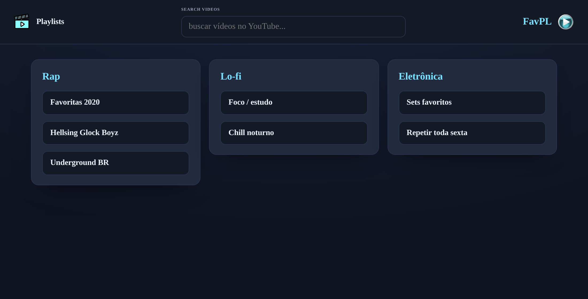

#  FavPlaylists

> :cyclone: *Um lugar para salvar vídeos favoritos em playlists.*

Salve seus vídeos favoritos da internet organizados em **playlists**, que ficam
em bandejas na home. Dá também para colocar um vídeo em **loop por um período**
definido.



Stack: **React** (front-end, com `video-react` e `redux`) + **Node/Express**
com **Knex** e **SQLite** (back-end).

## :rocket: Como rodar

Precisa de **Node.js**. Abra dois terminais.

**1. Servidor** (pasta `server/`):

```sh
cd server
npm install
npm start              # sobe a API em http://localhost:3333
```

**2. Front-end** (pasta `web/`):

```sh
cd web
npm install
npm start              # abre http://localhost:3000
```

> O projeto foi feito com Yarn na época; os comandos acima usam npm, mas
> `yarn` também funciona.

## :abcd: Como funciona

- **Playlists:** clique em **Playlists** para ver as bandejas por tipo. Clique
  em uma playlist para abrir seus vídeos no player.
- **Buscar vídeos:** use o campo de busca no topo, aperte Enter e escolha um
  resultado.
- **Criar / adicionar:** clique em **FavPL** para abrir o formulário e criar uma
  playlist nova ou adicionar um vídeo a uma existente.
- **Loop por período:** os botões abaixo do vídeo definem um intervalo em que o
  vídeo fica repetindo. Pause o vídeo para parar o loop.

## :v: Quer ajudar?

- Faça um fork
- Mande sugestões
- Dê uma star no projeto

**Obrigado, aproveite** :wink:
